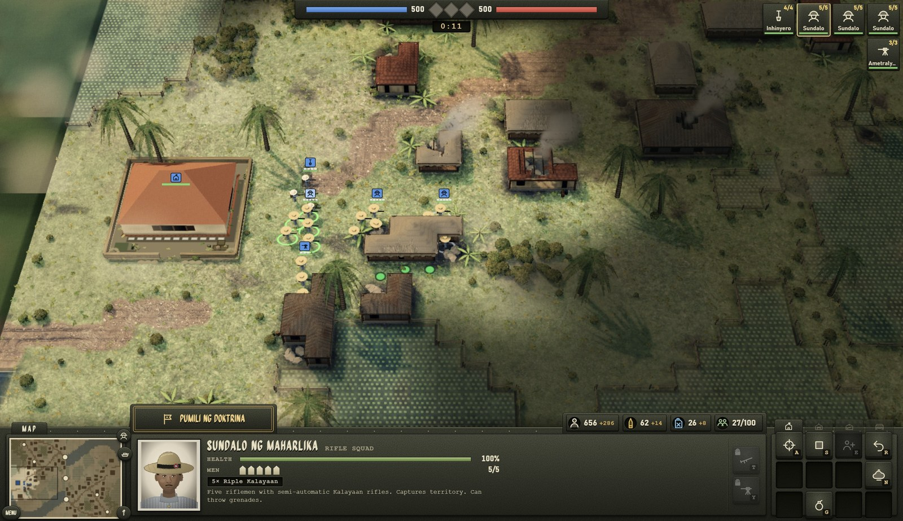

### Rilis Terbaru 
    
##### [English](README.md) | [Tagalog](README.tl.md) | [Español](README.es.md) | [Português](README.pt-BR.md) | [日本語](README.ja.md) | [简体中文](README.zh-CN.md) | **Bahasa Indonesia**
----

Game taktik real-time berbasis regu untuk Windows, berlatar di Luzon.

Versi 0.9.2 · Kampanye, Teater Perang dan Skirmish melawan AI · Offline

<picture></picture>
Konsep tampilan yang sedang dituju game ini.

---

## Dapatkan game

- **Windows 10 atau 11:** [Halaman rilis](https://github.com/og-cz/taga-komando/releases)
  - `TagaKomando-Setup-<version>.exe`: penginstal (pintasan menu Start, pencopot instalasi)
  - `TagaKomando-Portable-<version>.exe`: satu file, tanpa instalasi, bisa dijalankan dari mana saja
- **Peringatan "Windows melindungi PC Anda":** aplikasi belum ditandatangani. Klik **Info selengkapnya → Tetap jalankan**.
- **Laporan bug / saran:** https://github.com/og-cz/taga-komando/issues

## Dokumentasi

Semua tentang cara bermain dan membangun game ada di **[dokumentasi](README.md)** (bahasa Inggris).

- [Persyaratan sistem](README.md#system-requirements)
- [Instalasi](README.md#install)
- [Pertempuran pertama](README.md#how-to-play)
- [Mode permainan](README.md#game-modes)
- [Kontrol](README.md#controls)
- [Unit](README.md#units)
- [Doktrin](README.md#doctrines)
- [Pemecahan masalah](README.md#troubleshooting)
- [Catatan perubahan](docs/CHANGELOG.md)
